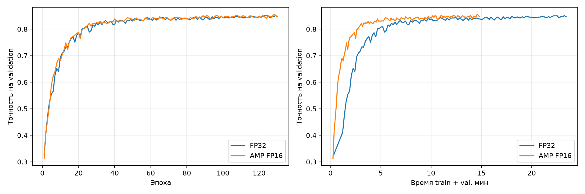

# AlexNet Training Optimization on CIFAR-10

В этом проекте я разбирался, почему моя реализация AlexNet на CIFAR-10 обучается медленно и что можно ускорить. Профилирование показало, что заметная часть времени уходила на подготовку данных. Пока основной процесс по очереди применял AutoAugment и стандартизацию к изображениям, GPU ждал следующий батч.

Я настроил параллельную подготовку данных, убрал повторные преобразования типов и перенёс стандартизацию целого батча на GPU. После этого провёл отдельный эксперимент, чтобы понять, как точность вычислений влияет на скорость обучения. Для сравнения обучил модель в FP32 и со смешанной точностью AMP FP16 на одинаковое число эпох. Измерил общее время с учётом валидации и сравнил точность моделей на валидационной выборке.

## Эксперименты и результаты

Все замеры сделаны на NVIDIA RTX 2080 Ti.

**AutoAugment.** В исходном цикле подготовка батча занимала 267 мс из 392 мс. Когда я отключил AutoAugment, подготовка сократилась до 23 мс, а весь шаг занял 146 мс. Это помогло понять, почему GPU простаивал между батчами.

**Число workers.** С включённым AutoAugment я сравнил 0, 2 и 4 workers в FP32 без профайлера. Время батча составило 298,2, 127,1 и 128,3 мс соответственно. Два workers ускорили шаг в **2,35 раза**. Четыре работали примерно с той же скоростью.

**FP32 и AMP FP16.** На обновлённом цикле с двумя workers я сравнил два режима точности. В профиле среднее время шага сократилось со 119,88 до 74,39 мс. Обучение за 130 эпох вместе с валидацией заняло 23 мин 25 с в FP32 и 14 мин 48 с с AMP. Это ускорение в **1,58 раза**. Средняя точность на валидации за последние пять эпох составила **84,65% в FP32** и **84,93% с AMP**.

На графике слева показана точность по эпохам, справа по времени обучения с валидацией. [Ноутбук с результатами обучения](notebooks/02_training.ipynb) · [Подробный разбор экспериментов](docs/experiments.md)

## Трейсы для Perfetto

Скачайте нужный JSON и откройте его в Perfetto через **Open trace file**. В [короткой инструкции](docs/perfetto.md) есть SQL-запрос для сравнения времени шагов.

- [Трейс FP32](docs/traces/training_trace_fp32.json)
- [Трейс AMP FP16](docs/traces/training_trace_amp_fp16.json)

## Как запустить

1. Выберите окружение с Python 3.10+, PyTorch для CUDA и подходящей версией torchvision. В нём выполните `python -m pip install -r requirements.txt`.
2. Подключите датасет. В корне проекта должны быть `data/train/*.png` и `data/trainLabels.csv`. Если данные уже лежат в `~/CIFAR-10/data`, можно подключить папку командой `ln -s "$HOME/CIFAR-10/data" data`.
3. Откройте [01_profiling.ipynb](notebooks/01_profiling.ipynb) в CUDA-ядре и запустите ячейки сверху вниз. По умолчанию сохранятся трейсы FP32 и AMP. Сравнение AutoAugment и числа workers можно включить в ячейке с параметрами.
4. Завершите ядро профилирования и запустите [02_training.ipynb](notebooks/02_training.ipynb). Сначала обучится FP32, затем AMP. Для быстрой проверки поставьте `EPOCHS = 2`. Для сравнения из README оставьте `EPOCHS = 130`.

Размер батча 512, разбиение данных 80/20, seed 52. Оптимизатор Adam использует скорость обучения 0,0003. Каждый запуск создаёт свою модель и свой даталоадер. Если на сервере мало памяти, запускайте ноутбуки по очереди.

| Что появится после запуска | Содержимое |
|---|---|
| `artifacts/traces/training_trace_fp32.json` | Трейс FP32 |
| `artifacts/traces/training_trace_amp_fp16.json` | Трейс AMP FP16 |
| `artifacts/{fp32,amp_fp16}/history.csv` | Метрики и время каждой эпохи |
| `artifacts/{fp32,amp_fp16}/best.pth` | Веса лучшей эпохи по точности на валидации |
| `artifacts/comparison.csv` | Итоговое сравнение |
| `artifacts/validation_accuracy.png` | График точности по эпохам и времени |

## Исходный код и проверки

AlexNet взят из [моего проекта CIFAR-10](https://github.com/artem-melikhov/CIFAR-10/tree/85bce29cc2244516b6031185524d65dd693d33a7). По коммитам можно пройти от исходного варианта до финального и посмотреть, как менялись данные, метрики и режим обучения. [Схема AlexNet](docs/alexnet.svg)

Чтобы проверить код на небольших синтетических данных, установите pytest командой `python -m pip install pytest` и запустите `python -m pytest -q` из корня проекта.
